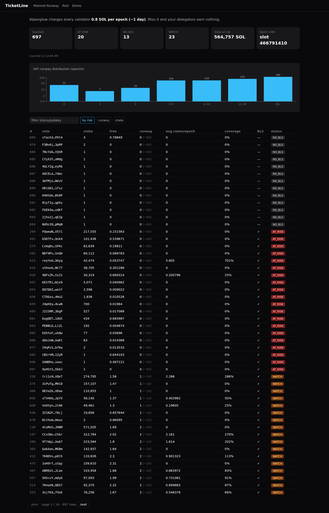
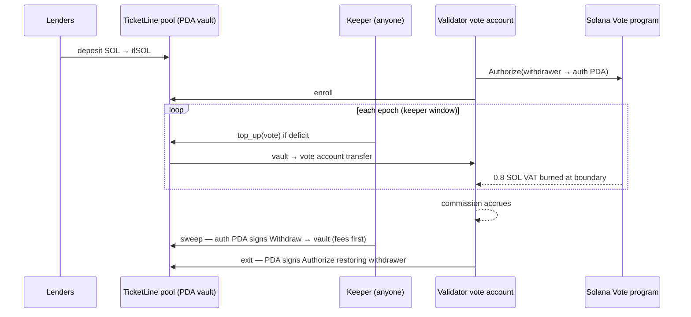
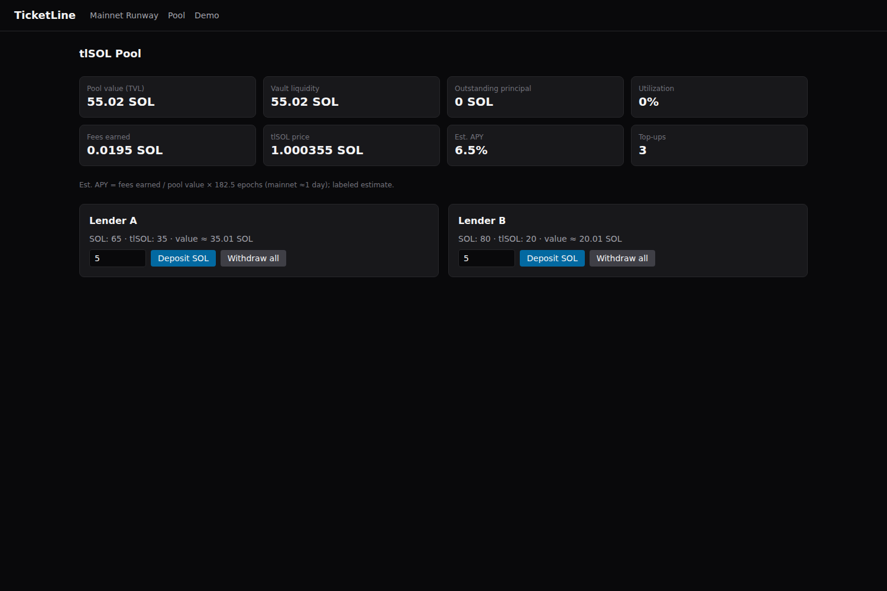
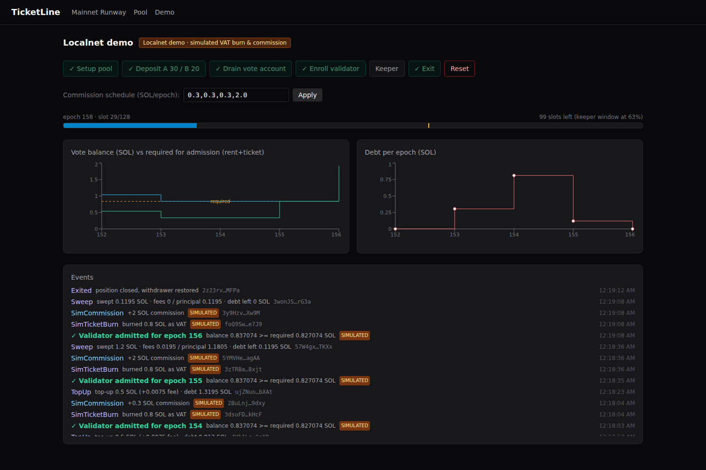

# TicketLine

**A credit line for Solana validator admission.** Lenders deposit SOL into an on-chain pool; the pool automatically pays each enrolled validator's per-epoch admission ticket; validators repay from their inflation commission — while a PDA safely holds withdraw authority over the vote account.

- **Problem:** Solana's Alpenglow upgrade charges every validator a 0.8 SOL Validator Admission Ticket (VAT) every epoch. A validator whose vote account can't cover it is not admitted — it casts no votes, produces no blocks, and its delegators earn nothing.
- **Product:** an Anchor lending pool that keeps validators admitted and pays lenders a fee on every top-up. On mainnet (epoch 1080 scan) 33 vote accounts sit below one ticket of free balance — ~565k SOL of stake is on accounts that are AT_RISK or lack a BLS key.
- **Why Solana:** vote accounts have a programmable *authorized withdrawer*, so a PDA can hold a capability — not a key — that is provably limited to paying the ticket and repaying the pool.
- **Status:** full on-chain program + 34 LiteSVM tests green (35 with the `demo-sim` feature); mainnet runway scanner over all 697 vote accounts; a scripted localnet rescue demo (`pnpm demo:fresh` → `pnpm demo:e2e`) and a live dashboard.

**Track:** DeFi  •  **Demo video:** VIDEO_LINK_HERE


*The `/` page: every mainnet vote account scanned and classified by how many epochs its free balance can still cover the VAT.*

## The problem

Alpenglow went live on Solana mainnet at epoch 1064 (2026-10-21). Under SIMD-0357, being an "eligible" validator for an epoch requires:

1. a BLS public key registered on the vote account,
2. activated stake greater than zero, and
3. enough balance to pay the **Validator Admission Ticket (VAT)**: `lamports − pending_delegator_rewards ≥ rent_exempt_minimum + VAT`. The 0.8 SOL VAT is then burned from the vote account at the epoch boundary.

A validator is a program-owned **vote account** (the Vote program's stake-tracking account). Lamports land in it as rewards, but nothing inside Solana tops it up if it runs short — today operators watch dashboards and alerts, then manually transfer SOL. Miss a ticket and the validator is simply not admitted for the epoch: no votes, no blocks, and every delegator on that validator earns nothing for that epoch (about one day at mainnet's current 200 ms slots).

This is a real risk, not a corner case. A full scan of all mainnet vote accounts (see `data/mainnet-snapshot.json`, epoch 1080, scanned 2026-11-08):

| Status | Meaning | Count |
|---|---|---|
| SAFE | runway ≥ 3 epochs | 641 |
| WATCH | runway 1–3 epochs | 23 |
| AT_RISK | runway < 1 epoch — cannot cover the next ticket | 20 |
| NO_BLS | no BLS key — ineligible regardless of balance | 13 |

684 of 697 vote accounts have BLS keys. AT_RISK + NO_BLS accounts carry ~**564,757 SOL** of activated stake.

Sources: [solana.com Alpenglow VAT upgrade](https://solana.com/upgrades/bls-pubkey-vat) · [SIMD-0357](https://github.com/solana-foundation/solana-improvement-documents/blob/main/proposals/0357-alpenglow_validator_admission_ticket.md) · [xroot.dev admission write-up](https://xroot.dev/blog/alpenglow-validator-admission-2000-seats) · [JPool validator FAQ](https://docs.jpool.one/validator-docs/additional-information/faq)

## The solution

TicketLine turns "keep the vote account funded" into a credit product. Lenders deposit SOL into an on-chain pool and receive **tlSOL** LP shares. A validator *enrolls* by pointing its vote account's **authorized withdrawer** — the address allowed to withdraw lamports — at a program-derived address (a **PDA**: an address only the program can sign for). From then on, a permissionless keeper watches the epoch clock: shortly before the epoch boundary, if the vote account can't cover the ticket, the pool tops it up and records debt. After admission, the validator's inflation commission accrues into the same account, and anyone can call **sweep** to repay the pool — fees first, then principal. When the debt is zero the validator can exit and get its withdrawer back.

| Who | Gets |
|---|---|
| Lenders | Yield: a 1.5% fee on every ticket top-up, denominated in tlSOL share price |
| Validators | Stay admitted whenever the shortfall fits within their credit limit, instead of losing a reward epoch to an empty vote account (credit can't fix a missing BLS key or zero stake) |
| Delegators | Uninterrupted rewards (the people who actually lose when a validator misses admission) |
| Keepers | Permissionless: anyone can crank top-up/sweep; no special role needed |

## How it works

1. Lender **deposits** SOL → pool vault; mints tlSOL shares at the current share price.
2. Validator **enrolls**: it sets the vote account's authorized withdrawer to the `["auth", vote]` PDA (a normal `Authorize` instruction it signs once) and calls `enroll` with its node identity key. The program verifies the withdrawer really is the PDA, the account has a BLS key, and inflation rewards collect back into the account.
3. Before each epoch boundary the **keeper** checks the vote account's free balance. If it can't cover `rent + ticket + pending rewards + buffer`, `top_up` moves the **full deficit** from the vault, takes a fee, and records principal + fee debt on the position (bounded by a credit limit the oracle sets).
4. The epoch turns; the ticket burns; the validator stays admitted. Inflation commission accrues to the vote account.
5. Anyone calls **sweep**: the auth PDA signs a Vote `Withdraw` CPI moving the repayable surplus back to the vault — fees first, then principal — while never touching the reserve the vote account must keep.
6. With debt at zero the validator may **withdraw_surplus** or **exit**: the PDA signs `Authorize` restoring the previous withdrawer and the position closes.



## Why this only works on Solana

- **Vote accounts with a programmable authorized withdrawer.** A PDA can hold the *capability* to withdraw — not a private key — so the program can prove the only destinations are: the pool vault (repayment), the validator's payout (its own surplus), or the burn (the ticket). Lent SOL can only be burned as the ticket or repaid; while debt is outstanding the validator has no way to withdraw it or take back the withdraw authority.
- **PDAs signing real CPIs.** `sweep`/`exit`/`sim_ticket_burn` make the PDA `invoke_signed` into the Vote program's `Withdraw`/`Authorize` instructions — no custody, no wrapped proxy account.
- **Epoch-based admission.** The failure mode is discrete and predictable: one ticket per epoch, checked before a boundary — perfect for an automated credit line.
- **Cheap cranks.** A once-per-epoch top-up/sweep costs a fraction of a cent, so "insurance" needs no subsidized operator.

## Code tour for reviewers (5 files)

| Read this | To see |
|---|---|
| [`programs/ticketline/src/instructions/top_up.rs`](programs/ticketline/src/instructions/top_up.rs) | How the pool covers a deficit: once per epoch, capped by credit limit and vault liquidity |
| [`programs/ticketline/src/instructions/sweep.rs`](programs/ticketline/src/instructions/sweep.rs) | PDA-signed Vote `Withdraw` CPI, reserve floor, fees-first repayment |
| [`programs/ticketline/src/instructions/exit.rs`](programs/ticketline/src/instructions/exit.rs) | Exit blocked while in debt; PDA-signed `Authorize` hands the withdrawer back |
| [`programs/ticketline/src/vote.rs`](programs/ticketline/src/vote.rs) | Fixed-offset VoteStateV4 parser and hand-encoded Vote program instructions |
| [`services/backend/src/keeper.ts`](services/backend/src/keeper.ts) | The permissionless keeper: top-up window, epoch-boundary sequence, error handling |

## Demo walkthrough — what you see in the video

The repo ships a self-contained localnet demo (Agave test validator + backend keeper + dashboard on `localhost:3000`).

- **`/` Mainnet runway** (screenshot above): live mainnet data — every vote account's runway and status.
- **`/pool`**: pool TVL, vault liquidity, utilization, fees earned, tlSOL share price, lender cards with deposit/withdraw.


*Pool after the full rescue scenario: 55 SOL deposited across two lenders, debt fully repaid (0 outstanding), 0.0195 SOL of fees earned from 3 top-ups, which lifts the tlSOL share price to 1.000355. The APY figure is a labeled extrapolation from this short run, not a forecast.*

- **`/demo`** drives the story: *Setup → Deposit A/B → Drain vote account → Enroll → keeper runs automatically → Exit.*


*The rescue: vote balance (solid) vs required-for-admission floor (dashed = rent + ticket); dips below the floor trigger top-ups. Debt chart tracks principal+fee owed. The event feed shows top-ups, epoch-boundary `SIMULATED` burns, commission, sweeps, and the green "Validator admitted" line.*

Actual `pnpm demo:e2e` output on this code (136 s, ~30 s epochs):

| Metric | Result |
|---|---|
| Epochs observed | 5 |
| Top-ups (keeper, automatic) | 3 |
| Sweeps | 2 |
| Fees earned by pool | 19,500,000 lamports |
| Final tlSOL share price | 1.000355 |
| Admitted every epoch | yes |
| Withdrawer restored on exit | yes |
| Assertions | 9/9 PASS |

## On-chain program

Program ID: `HDbnoeCddu4hK3JzX78TS4RAq6ZVypvqMhXwk7CEbHyq` — `programs/ticketline/` (Anchor 1.2.2, Rust).

### Accounts

| Account | Seeds | Holds |
|---|---|---|
| Pool | `["pool"]` | admin, oracle, fee_bps, ticket/buffer/credit params, totals, bumps |
| Vault | `["vault", pool]` | system-owned, 0 data — holds all lent SOL |
| LP mint | `["lp", pool]` | SPL Token mint (9 dp); authority = pool PDA → tlSOL |
| Position | `["pos", vote]` | one per vote account: debt principal/fees, credit limit, payout, bumps |
| Auth | `["auth", vote]` | zero-data PDA set as the vote account's withdrawer |

### Instructions

| Instruction | Signer | Does | Guards |
|---|---|---|---|
| `init_pool` | admin | creates pool, vault, tlSOL mint | — |
| `update_params` | admin | updates fee/ticket/buffer/credit/oracle (Option fields) | admin only |
| `deposit` | lender | SOL → vault, mint tlSOL | mints > 0 shares |
| `withdraw` | lender | burn tlSOL → SOL | pool liquidity |
| `enroll` | node identity | opens position, sets payout | withdrawer = auth PDA, BLS key present, inflation collector = vote account |
| `set_credit_limit` | oracle | sets position credit limit | oracle only |
| `top_up` | anyone (crank) | vault → vote account full deficit; records debt + fee | once/epoch, ≤ credit limit, ≤ vault available, deficit > 0 |
| `sweep` | anyone (crank) | PDA-signed Vote `Withdraw` → vault, fees then principal | never below reserve (rent + pending + ticket + buffer) |
| `withdraw_surplus` | owner (node id) | PDA-signed `Withdraw` → payout | debt = 0, reserve preserved |
| `exit` | owner | PDA-signed `Authorize` → restore withdrawer, close position | debt = 0 |
| `sim_ticket_burn` | anyone | `demo-sim` feature only: PDA-signed `Withdraw` to the incinerator | remaining ≥ rent + pending |

Every instruction that touches a vote account checks `owner == Vote program` and `key == position.vote_account`. All arithmetic is checked (`MathOverflow`); vote account parsing is a fixed-offset VoteStateV4 header reader with no runtime dependency on `solana-vote-interface`.

### Math

- `deposit shares = lamports × lp_supply / pool_value` (initial: 1:1); `pool_value = vault_available + outstanding_principal`; `share price = pool_value / lp_supply` — fees accrue to LPs through the price.
- `required = rent_min(vote.data_len) + ticket + pending_rewards + buffer`; `deficit = max(0, required − lamports)`; top-up covers the *whole* deficit.
- `sweepable = lamports − (rent + pending + ticket + buffer)`; sweep repays `min(sweepable, fees + principal)`, fees first.

### Safety invariants → tests (`programs/ticketline/tests/`)

| Invariant | Tests |
|---|---|
| Lamports only leave the vote account to the vault, the owner's payout, or the incinerator | `sweep_repays_fees_first_and_respects_reserve`, `surplus_withdraw_to_payout_bounded`, `exit_blocked_with_debt_then_restores_withdrawer`, `sim_ticket_burn_respects_floor` |
| Sweep/surplus never breach the reserve; burn never breaches rent + pending | `sweep_respects_pending_rewards_in_reserve`, `surplus_withdraw_to_payout_bounded`, `sim_ticket_burn_respects_floor` |
| No exit or surplus while debt > 0 | `exit_blocked_with_debt_then_restores_withdrawer` |
| Share price never decreases | `share_price_never_decreases_full_scenario` |
| ≤ 1 top-up per epoch; debt ≤ credit limit | `second_top_up_same_epoch_rejected_next_epoch_allowed`, `top_up_credit_cap_enforced` |

## Off-chain

- **`packages/sdk`** — IDL + types, PDA derivations, the same VoteStateV4 parser in TS, pool math (parity-tested against the Rust tests), and instruction builders.
- **`services/backend`** (Fastify, port 8787):
  - *Mainnet scanner*: `getEpochInfo` → `getVoteAccounts` → `getMultipleAccounts` (batches of 100) → V4 parse → `getMinimumBalanceForRentExemption` per account + `getInflationReward` (last 5 epochs, batches of 32, with retry). Per account it computes `free = lamports − pending − rent`, `runway = floor(free / ticket)`, `status = NO_BLS | AT_RISK (<1) | WATCH (1–3) | SAFE (≥3)`; writes `data/mainnet-snapshot.json`, serves `GET /mainnet/runway` (cached, `stale` flag on RPC failure).
  - *Keeper*: 1 s tick; when `slots_remaining ≤ 48` and the vote account has a deficit → `top_up`; on each epoch change it runs (a) admission check vs the on-chain `ticket_lamports`, (b) one `sim_ticket_burn`, (c) scheduled commission transfer, (d) `sweep` — in that order. Anchor errors are decoded from logs **and** `custom program error: 0xN` codes via the IDL (`errdecode.ts`); expected errors are silent, real blocks emit deduped `TopUpBlocked`/`SweepFailed` events.
  - *API*: `GET /health`, `GET /mainnet/runway`, `POST /mainnet/refresh`, `POST /demo/{setup,deposit,withdraw,drain,enroll,commission-schedule,exit,reset}`, `POST /oracle/apply`, `POST /keeper/{start,stop}`, `GET /localnet/state`, `GET /events` (SSE, 200-event ring buffer).
- **`apps/web`** (Next.js, port 3000): the three pages above; SWR polling + SSE feed; no wallet adapter needed.

## Real vs simulated — read this before judging

| Piece | Real or simulated | Why |
|---|---|---|
| Pool accounting, tlSOL minting, share price, fees | **Real** on-chain program | — |
| PDA holds vote-account withdraw authority | **Real** — actual `Authorize`/`Withdraw` CPIs signed by the PDA | — |
| Top-up, sweep, exit, all guards/errors | **Real** on-chain | — |
| Mainnet runway page | **Real** read-only mainnet data | — |
| VAT burn on localnet | **Simulated**: feature-gated `sim_ticket_burn` PDA-burns the ticket each epoch (marked SIMULATED) | Agave 4.3.2 localnet has the VAT rules active but **SIMD-0326/Votor inactive**, so the ticket is never actually burned |
| Commission on localnet | **Simulated**: scheduled lamport transfers from a `rewards` keypair | localnet pays no inflation rewards |
| Admission check | **Computed by the backend** per SIMD-0357's rule, against the real on-chain `ticket_lamports` | there is no localnet admission to observe |

None of the simulated parts touch the program's authority model or economics — the same binary runs unchanged when VAT is real.

## Testing & verification (all run on this code)

- `cargo test -p ticketline` — **34 tests pass**; `cargo test -p ticketline --features demo-sim` — **35** (adds `sim_ticket_burn_respects_floor`).
- `pnpm -r typecheck` clean; `pnpm -r test` — SDK 10/10, backend 5/5 (errdecode suite). Web has no test suite.
- `pnpm demo:e2e` — the table above: 9/9 assertions, 136 s.
- `pnpm scan:once` — produced the epoch 1080 snapshot above. The vote-account parser was checked field by field against RPC `jsonParsed` output on a live mainnet account.

## Run it yourself

Prereqs (Linux or WSL2): Rust stable (1.99.x tested), Agave **4.1.2** toolchain for builds with Agave **4.3.2** `solana-test-validator`, Anchor/AVM **1.2.2**, Node **22**, pnpm **12**.

```bash
pnpm install
anchor build                                  # base program
anchor build -- --features demo-sim           # localnet demo build (deployed by localnet.sh)
pnpm demo:fresh                               # validator :8899 + backend :8787 + web :3000
# open http://localhost:3000 — walk /demo, or:
pnpm demo:e2e                                 # scripted full rescue, ~2.5 min
pnpm demo:stop
pnpm scan:once                                # optional: refresh mainnet snapshot (public RPC works)
```

Troubleshooting: after a WSL idle-shutdown or ledger reset run `pnpm demo:fresh` (it restarts the backend, which the reset requires); if :3000 is wedged, `pnpm demo:web` group-kills the old server and rebuilds.

## Repo layout

```
programs/ticketline/          Anchor program: state, math, vote parser + CPI encoders, 11 instructions, events, errors
programs/ticketline/tests/    LiteSVM suite (35 tests) — encoding, pool, enroll, top_up, sweep, surplus, exit, share_price, sim
packages/sdk/                 TS: IDL/types, PDAs, vote parser, math, ix builders (vitest)
services/backend/             Fastify: mainnet scanner, keeper, demo API, SSE (vitest)
apps/web/                     Next.js dashboard (/, /pool, /demo)
scripts/                      localnet.sh, demo-{fresh,web,stop}.sh, demo-e2e.ts, screenshot.mjs, spike utilities
data/                         mainnet-snapshot.json + vote-account fixtures
docs/screenshots/             dashboard captures
```

(`security.json` is Anchor's scaffold metadata file.)

## Trusted roles, limitations, roadmap

- **Roles:** `admin` (pool params, set at `init_pool`), `oracle` (per-validator credit limits — in the demo admin doubles as oracle), `owner` = the vote account's node identity (payouts, exit). Keepers are permissionless.
- **Limitations:** credit is oracle-trusted. Default risk sits with lenders: if an enrolled validator stops earning commission, its debt is never repaid. The PDA keeps the withdraw authority, so the validator can't exit or pull funds, but nothing forces repayment and there is no liquidation path; yield depends on inflation commission only; demo runs a single validator on localnet; not deployed to devnet/mainnet.
- **Roadmap:** on-chain credit scoring from reward history (replacing the oracle), keeper crank rewards, routing block-revenue collector too (SIMD-0232), devnet deployment, multi-validator localnet harness.
